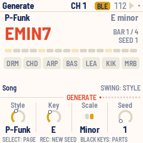
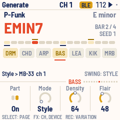
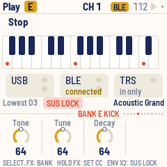

# GEN-1 for the M-VAVE FM-1

GEN-1 is Grumo's fork of [CTL-1](https://github.com/charlesvestal/fm1-ctl), Charles Vestal's MIDI controller
firmware for the M-VAVE FM-1. It keeps everything CTL-1 does and adds a **Generate** page: seven generative parts
(drums, chords, arpeggio, bass, lead, a melodic kick and a random-note part after Mutable Instruments' Marbles)
that follow one key, one chord progression and one of 24 styles, in time with an external MIDI clock. It makes no
sound of its own that matters: it sends notes and controllers over USB for other instruments to play, and was
written around one studio (an MPC Live II as clock and recorder, an MFB Tanzbar Lite, a MAM MB-33, a Dreadbox
Hades, a Korg Monologue, a Roland JV-1010, a Volca FM, a Jomox MBase 11 and a Simmons SDS-200).

  

What the fork adds:

- **Generate** (press SEQ twice): style, key, seed, swing; a page for each part; pages for the drum lanes' notes,
  Grids and tuning. The first seven black keys switch the parts on and off.
- **One seed.** Everything a part plays comes from the seed, the style, the key and the bar number, so parts
  recorded one after another on a sequencer fit each other bar for bar.
- **Instrument profiles**: each part knows how its instrument takes an accent and a slide, its range, and which
  controller moves its filter.
- **Twelve knob banks** on Play: CTL-1's four, and eight (E to L) with the Tanzbar Lite's controllers, voice by
  voice.
- CTL-1's own Euclidean sequencer is still on SEQ; its tracks now start muted.

- **Manual**: [docs/MANUAL.md](docs/MANUAL.md); the generators are section 17
- **Firmware file**: built on GitHub from this repository (Actions, "Build and attest firmware", Run workflow);
  the run's `packages` artifact holds `ctl.fwsc` (USB, TRS and Bluetooth MIDI) and `ctl-usb.fwsc` (no Bluetooth)
- **CTL-1 itself**, its emulator and its installer: <https://github.com/charlesvestal/fm1-ctl>

This fork has run in the simulator only so far, not yet on an FM-1. Installing it is at your own risk, though it's
hard to get stuck: the web installer can put M-VAVE's own firmware back, and an FM-1 that fails to start twice comes
up in a safe mode the installer can reach.

## In short

| | |
|---|---|
| Keys | Notes; with a scale, its notes on the white keys and its chords on the black keys |
| KNOB 1–4 | The page's four values; on Play, four controllers in twelve banks |
| HOME · SEL · ARP · SEQ · EDIT · GLO | The pages: Play, Keys, Arp, Sequencer, Sound, Setup |
| SELECT | The page's own pages: the banks on Play, the tracks on the Sequencer |
| ALGORITHM · PRESETS · MASTER | MIDI channel · program change (the sound follows) · volume |
| FX | The next bank; held, KNOB 1–4 set its controller numbers |
| ENV · LFO | Sustain (tap twice to lock) · mod wheel |
| PLAY · REC · SAVE | Start / stop · panic · save |
| OCT− / OCT+ | An octave down or up |

The [manual](https://charlesvestal.github.io/fm1-ctl/manual/) has the rest.

### Screen reader

CTL-1 tells the [FM-1 Screen Reader](https://charlesvestal.github.io/fm1-reader/) what its screen shows,
over USB: the page and its knobs, a knob's value as it turns (a controller with its name, "CC 74 cutoff
64"), the channel and the program, the Sequencer's steps and mutes, the Touch settings, play and stop,
and what each button did (the notes you play are not read out). Open the
page in Chrome with the FM-1 plugged in; it speaks with its own voice, or hands the text to your
computer's screen reader. The reader's messages stay between it and CTL-1: they are never passed on to
Bluetooth.

## Building and testing

GEN-1, like CTL-1, is an app on [fm1-base](https://github.com/charlesvestal/fm1-base) (`base/`, a git submodule); clone with
`--recursive`. The toolchain and prerequisites are in [BUILDING.md](BUILDING.md):

```
sh tests/run_tests.sh                                  # the app in the simulator, the emulator, the update path
./build.sh                                             # app/build/ctl.fwsc
./build.sh --no-ble                                    # app/build/ctl-usb.fwsc: without Bluetooth
python3 base/tools/fm1_install.py app/build/ctl.fwsc   # install it over USB
```

`app/build/host/ctl_host SCRIPT OUTDIR` runs the whole app on a computer from a script
(`tests/scenarios/*.ctl`), with screenshots and the MIDI sent coming out; `tools/gen_screens.sh` makes the
manual's screenshots. `./build.sh --web` builds the same code for the browser (the emulator), which can play a
real MIDI port through Web MIDI.

Bluetooth starts at every boot and advertises as "FM-1" (on a Mac: Audio MIDI Setup, Window, Show MIDI Studio,
the Bluetooth button, Connect); the Setup page shows the stack's log, which survives a reset.

## Credits

The platform (hardware layer, USB, update loader, storage, installer, Bluetooth) is
[fm1-base](https://github.com/charlesvestal/fm1-base) on [felucca-bsp](https://github.com/hugelton/felucca-bsp),
from [Felucca](https://github.com/hugelton/Felucca) by Leo Kuroshita (Hügelton Instruments), by way of
[X0X](https://github.com/charlesvestal/fm1-x0x) and [FoMni-1](https://github.com/charlesvestal/fm1-fomni);
the top bar and knob row are X0X's. Bluetooth runs on JieLi's Bluetooth libraries (Apache-2.0). The General MIDI sounds are Sonivox EAS (Apache-2.0). The Euclidean
rhythms are Godfried Toussaint's reading of Bjorklund's algorithm. The idea of running FM-1 firmware in
the browser comes from [Groove OS](https://www.groove-os.com/). MPL-2.0; see [LICENSING.md](LICENSING.md).
